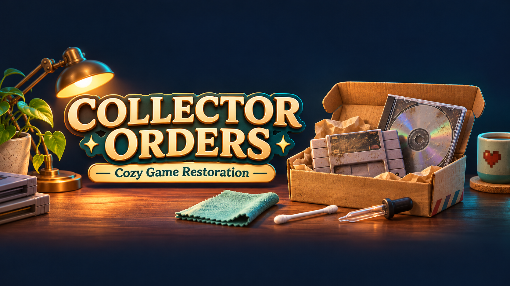

# Collector Orders 0.5.2

An optional addon for Cozy Game Restoration: buy a chosen **dirty** game instead of waiting for the matching random drop. It uses **F10 → Orders** in Cozy Tweaks, with no second menu.

[Nexus page](https://www.nexusmods.com/mods/2?game_id=11007) — submitted; public visibility awaits approval of the new game entry.

## Requirements and installation

- BepInEx 5 x64 / Unity Mono (developed with 5.4.23.6).
- **Cozy Tweaks 0.5.2 or newer**, installed separately.

Close the game and extract `CollectorOrders-0.5.2-Nexus.zip` into the game folder. The result must be `BepInEx/plugins/CollectorOrders/CollectorOrders.dll`. Replace old copies rather than retaining renamed DLLs. For old combined versions up to 0.3.x, replace the old core DLL with the new Cozy Tweaks package before adding this plugin.

UI defaults to Ukrainian. Click **English** at the top of F10 to change both plugins' language.

## How it works

1. Open the hub or parcel shop, then **F10 → Orders**. Ordering is blocked in other locations, with the reason displayed beside the purchase button.
2. Choose rarity, click a game title and choose an available region.
3. Check the quote and balance, then buy the dirty copy.
4. Delivery goes directly through native dirt preparation to the cleaning desk. There is no box-opening stage.
5. Clean the game normally; native completion adds it to the collection.

- Search the catalogue and optionally show only titles missing at the chosen rarity. This uses collection history, including sold copies; regions are not separate missing-collection entries.
- Choose Regular, Uncommon, Rare, Epic or Legendary, and a region actually supported by that title. Hidden special entries are excluded through the game's native filter.
- Default cost: **3× the current undiscounted market price**. Configure `PriceMultiplier` from 1.5 to 20 in `BepInEx/config/cozytweaks.collectororders.cfg`.
- One unfinished paid order per save slot. Payment and the order record use one database transaction. A stored paid order can be resumed without paying twice. Resuming regenerates the dirty item, so partial cleaning progress is not guaranteed.
- Random parcel probabilities are unchanged. There is no instant cleaning or unlock-all feature. Targeted rarity purchases intentionally change acquisition balance.

## Saves and uninstalling

The addon creates a `cozytweaks_collector_orders` table in the active save database on the first purchase. It records the paid order price as the copy's acquisition cost when collected. Keep a backup of your save before trying a beta mod.

Finish any paid order before removing `CollectorOrders.dll`. Uninstalling does not automatically refund or delete unfinished orders; reinstalling restores access to their stored record. Do not manually delete database tables.

## Status and credits

Public beta. The author manually confirmed buying a missing title and being sent straight to cleaning. Paid-order recovery across restarts has not yet been explicitly confirmed. No automated gameplay tests were run. Developed for the same Unity Mono build as Cozy Tweaks; future game updates may require changes.

Author: **RostyslavOstapyak**. Most code, UI, translations and release text were generated with **OpenAI Codex**, directed by the author. Nexus disclosure: **AI-Generated Content**; also disclose AI-written listing text where requested. No game assemblies, loader binaries, personal configuration or saves are included. Source is supplied for inspection/rebuilding without an additional licence grant.

