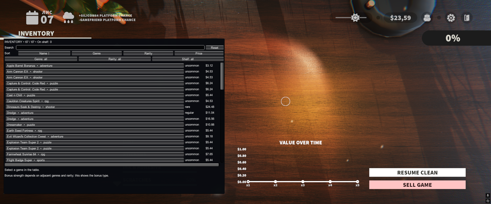
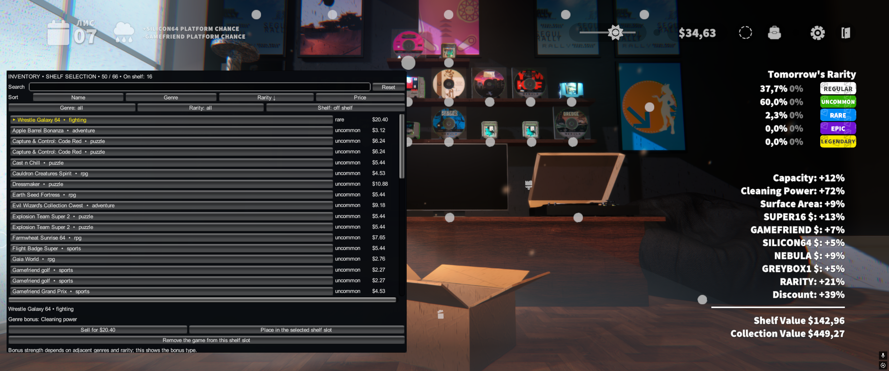
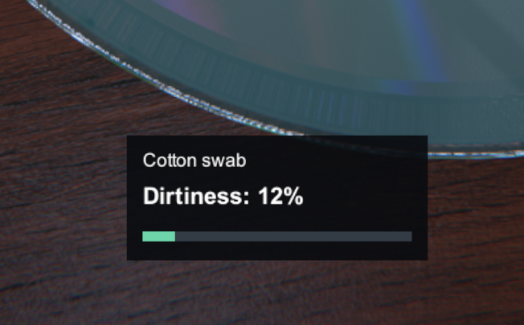
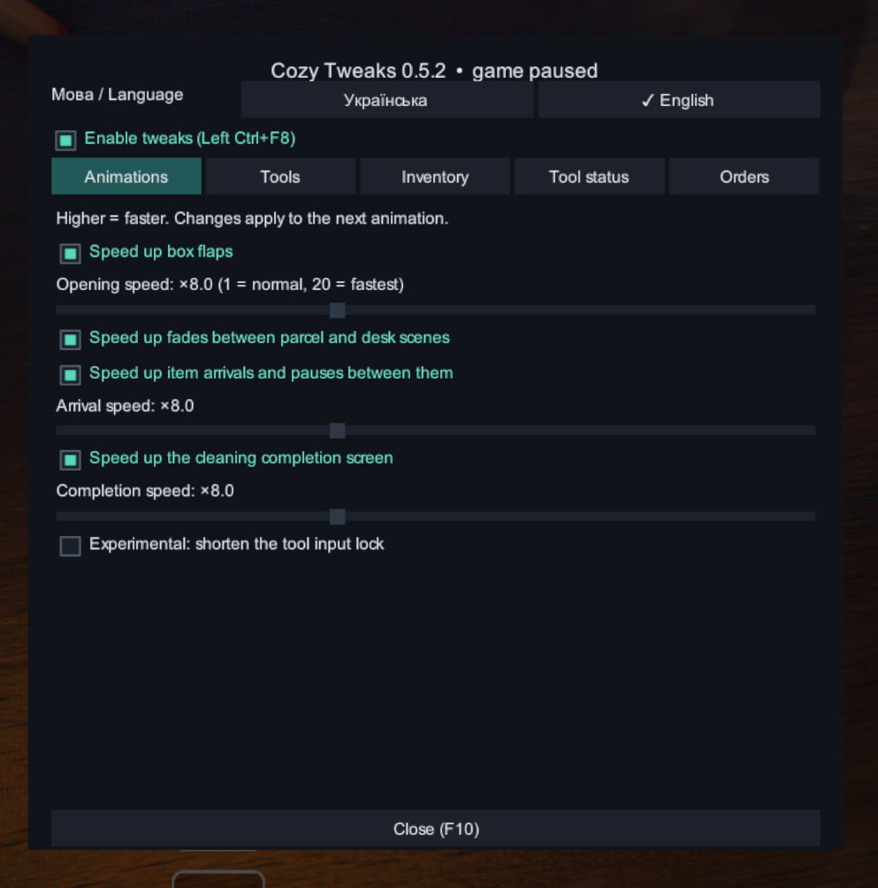

# Cozy Tweaks 0.5.2

Quality-of-life improvements for **Cozy Game Restoration**, with faster animations, custom tool shortcuts, a scrollable inventory and a movable tool-status indicator.

[Nexus page](https://www.nexusmods.com/mods/1?game_id=11007) — submitted; public visibility awaits approval of the new game entry.

## Install

1. Close the game.
2. Install [BepInEx 5.4.23.6, Windows x64 / Unity Mono](https://github.com/BepInEx/BepInEx/releases/tag/v5.4.23.6) beside `CozyGameRestoration.exe`. Use the `BepInEx_win_x64_5.4.23.6.zip` download, not BepInEx 6 or IL2CPP.
3. Extract `CozyTweaks-0.5.2-Nexus.zip` into that game folder. The mod must be at `BepInEx/plugins/CozyTweaks/CozyTweaks.dll`.
4. Start the game and press **F10**.

**Ukrainian is the default language. Click English at the top of F10 to change it.** The choice is saved and applies to the optional Orders addon too. This translates the mod interface, not the base game or its catalogue titles.

Replace older DLLs; keep only one copy of each plugin. Existing key bindings and settings are retained. No loader, game DLLs, personal configuration or saves are bundled.

## Features

- **Faster animations:** adjustable box flaps, item arrivals and their pauses, supported scene fades and post-cleaning presentation. Native collection updates and screenshot saving are retained.
- **Custom tool shortcuts:** eight configurable keyboard/mouse bindings with Ctrl, Shift and Alt support. Native controller mappings are retained. Automatic selection of tool 1's rotation submode was removed; choose submodes manually.
- **Scrollable inventory:** search, sorting by title, genre, rarity or current sale price; genre, rarity and shelf-status filters. Scroll position is retained after selling.
- **Shelf management:** shelf copies are marked and can be filtered. Select a slot, select a game, then place it. Selling a displayed copy requires removing it from the shelf first. Collapse or drag the table by its heading to reach obscured shelf slots.
- **Genre bonus hints:** show the affected cleaning statistic. They describe the bonus type, not a calculation of the final shelf combination.
- **On-demand native cards:** the table avoids creating every native inventory image card up front. No benchmarked loading-time claim is made.
- **Tool status:** remaining liquid/polish and dirtiness for supported swab/brush tools, displayed as a percentage with an optional colored bar. Dirtiness is 0% clean / 100% needs cleaning; supply is 100% full / 0% empty. Other tools hide the indicator.
- **Movable indicator:** F10 → Tool status → Move indicator, drag the panel, then Finish positioning or close F10. Position is saved. Reset position restores its default location.
- **One dark settings menu:** F10 pauses gameplay and blocks clicks reaching the game. Left Ctrl+F8 toggles core improvements. The optional shorter tool-input lock is experimental and off by default.

**Collector Orders is an optional separate plugin** using the Orders tab in this same menu. Install its package only if you want targeted purchases that change collection progression.

## Settings, compatibility and removal

Config: `BepInEx/config/cozytweaks.personal.qol.cfg`. Log: `BepInEx/LogOutput.log`.

Developed against Windows x64 / Unity Mono, Unity **2022.3.62f3**. Game script assembly SHA-256: `FDB38FE704DCA336289F052D7134305A6678013CBD161FE962E7C9E95A979A9A`. Future game updates and other mods are not guaranteed compatible.

Public beta. The author manually confirmed several animation, key-binding, inventory and ordering workflows during development. The latest indicator positioning fix has been installed but has not yet received explicit in-game confirmation. No automated gameplay tests were run. Supplied screenshots include earlier inventory layouts and the 0.5.2 settings/status interface.

To uninstall, close the game and remove `CozyTweaks.dll`. Remove Collector Orders first if installed, since it requires Cozy Tweaks. Finish any paid order before removing the addon. Keep your saves and original game files.

## Credits and disclosure

Author: **RostyslavOstapyak**. Most code, mod UI, translations and release text were generated with **OpenAI Codex**, guided by the author's requirements and manual feedback. Use the Nexus **AI-Generated Content** classification and disclose AI-written listing text where requested. Screenshots are user-provided gameplay captures, not AI-generated images. Promotional covers/headers were generated with the built-in OpenAI image-generation tool and are disclosed as AI Media.

Source is provided for inspection and rebuilding. No additional source-code licence is granted by this package. Game and third-party components remain owned by their respective owners.

## Screenshots

User-provided screenshots. The inventory and shelf images show an earlier UI revision; the status indicator and settings images show the later interface.

